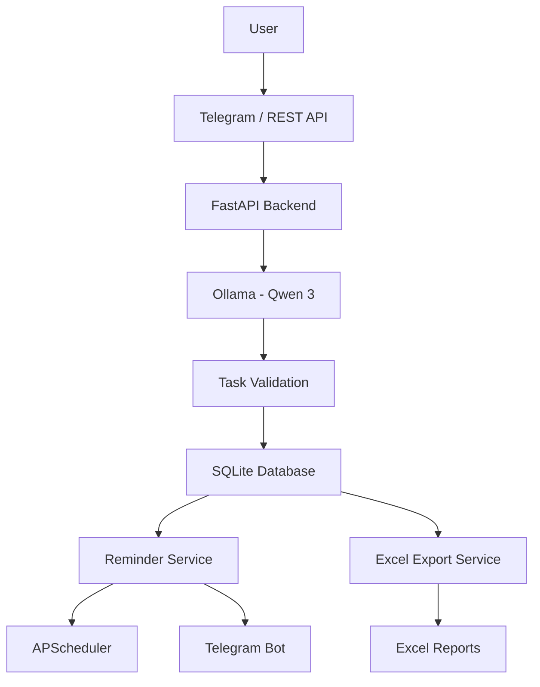

# AI TaskOps — AI-Powered Task Automation Platform

An AI-powered task management and automation system built using Python, FastAPI, SQLite, Ollama, n8n-compatible APIs, and Telegram.

AI TaskOps converts natural-language task instructions into structured tasks, stores them in a database, sends automated reminders, and generates Excel reports.

## Features

- **AI Task Extraction:** Uses Ollama and Qwen 3 to extract task descriptions, priorities, categories, and due dates from natural language.
- **Task Management:** Create, retrieve, update, and delete tasks through REST APIs.
- **Database Storage:** Stores tasks persistently using SQLite.
- **Telegram Notifications:** Sends task reminders directly to Telegram.
- **Automatic Scheduling:** Uses APScheduler to schedule daily and upcoming-task reminders.
- **Duplicate Prevention:** Tracks sent reminders in SQLite to avoid repeated notifications for the same task and reminder type/date.
- **Excel Reports:** Generates formatted Excel reports containing task information and summary statistics.
- **Automated Testing:** Uses Pytest to test API endpoints, validation, and CRUD operations.
- **Credential Protection:** Loads private configuration from a local `.env` file.

## Architecture



## Technology Stack

| Technology | Purpose |
|---|---|
| Python | Core programming language |
| FastAPI | Backend REST API |
| SQLite | Database |
| Ollama | Local AI model runtime |
| Qwen 3 (1.7B) | Natural-language task extraction |
| python-telegram-bot | Telegram integration |
| APScheduler | Automatic reminder scheduling |
| OpenPyXL | Excel report generation |
| Pydantic | Request validation |
| Pytest | Automated testing |
| Git and GitHub | Version control |

## Project Structure

```text
AI_TaskOps/
│
├── app/
│   ├── main.py
│   ├── database.py
│   ├── ollama_service.py
│   ├── telegram_service.py
│   ├── reminder_service.py
│   ├── scheduler.py
│   └── export_service.py
│
├── data/
├── exports/
│
├── tests/
│   ├── conftest.py
│   ├── test_health.py
│   ├── test_task_creation.py
│   ├── test_task_deletion.py
│   ├── test_task_retrieval.py
│   ├── test_task_update.py
│   └── test_task_validation.py
│
├── .env.example
├── .gitignore
├── requirements.txt
└── README.md
```

## Prerequisites

- Python 3.10 or later
- Git
- Ollama
- Telegram account
- Telegram bot created using BotFather

## Installation and Setup

### 1. Clone the repository

```bash
git clone https://github.com/gan1014/emoji.git
cd emoji
```

### 2. Create a virtual environment

```bash
python -m venv .venv
```

Activate it on Windows PowerShell:

```powershell
.venv\Scripts\Activate.ps1
```

### 3. Install dependencies

```bash
python -m pip install -r requirements.txt
```

### 4. Configure Ollama

Install and start Ollama, then download the model:

```bash
ollama pull qwen3:1.7b
```

Ensure Ollama is running locally.

### 5. Configure environment variables

Create your local `.env` file from the example:

```powershell
Copy-Item .env.example .env
```

Open `.env` and configure:

```env
TELEGRAM_BOT_TOKEN=your_telegram_bot_token
TELEGRAM_CHAT_ID=your_telegram_chat_id
```

Never upload your actual `.env` file or expose your bot token.

### 6. Start the FastAPI backend

```bash
python -m uvicorn app.main:app --reload
```

Open the API documentation:

http://127.0.0.1:8000/docs

### 7. Start automatic reminders

Open another terminal, activate the virtual environment, and run:

```bash
python -m app.scheduler
```

The default reminder schedule is:

- 8:00 AM IST — Tasks due today.
- 6:00 PM IST — Tasks due tomorrow.

Keep the scheduler process running for automatic reminders to execute.

## API Endpoints

| Method | Endpoint | Description |
|---|---|---|
| GET | `/` | Welcome endpoint |
| GET | `/health` | Backend health check |
| POST | `/tasks` | Create a task |
| GET | `/tasks` | Retrieve all tasks |
| GET | `/tasks/{task_id}` | Retrieve a specific task |
| PATCH | `/tasks/{task_id}` | Update a task |
| DELETE | `/tasks/{task_id}` | Delete a task |
| POST | `/tasks/ai` | Extract and create a task using AI |
| GET | `/tasks/export/excel` | Download an Excel report |

Interactive API documentation is available through FastAPI Swagger UI at `/docs`.

## Automated Testing

Run the complete test suite:

```bash
python -m pytest tests -v
```

The current test suite contains 11 tests covering:

- API health checks
- Task input validation
- Task creation
- Task retrieval
- Task updates
- Task deletion
- Temporary database isolation for tests

## Security

- Store Telegram credentials in `.env`.
- Keep `.env` excluded through `.gitignore`.
- Do not commit database files or generated reports.
- Use `.env.example` to document required configuration variables.

## Future Improvements

- n8n workflow integration
- Advanced AI task classification
- Semantic duplicate detection
- User authentication and authorization
- Improved logging and monitoring
- Task analytics dashboard
- Cloud deployment

## Project Goal

AI TaskOps demonstrates how AI models, REST APIs, databases, notification services, and workflow scheduling can work together to automate everyday task management.

**Built as a hands-on portfolio project in AI automation and backend integration.**